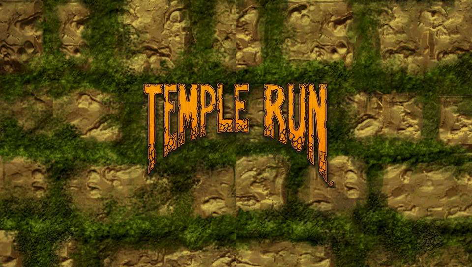

<h1 align="center">
  <br>
  Temple Run · PS Vita Port
</h1>

<p align="center">
  <b>Native port of Temple Run v1.5 (Imangi Studios) for PlayStation Vita and PlayStation TV.</b>
</p>

<p align="center">
  
  
  
  
  
  
</p>

<p align="center">
  <a href="#-description">Description</a> •
  <a href="#-features">Features</a> •
  <a href="#-controls">Controls</a> •
  <a href="#-installation">Installation</a> •
  <a href="#-known-issues">Known Issues</a> •
  <a href="#-building-from-source">Build</a> •
  <a href="#-credits">Credits</a>
</p>

---

## 📖 Description

An unofficial, native **iOS-to-PS Vita wrapper port** of *Temple Run* v1.5 (originally developed by **Imangi Studios**). There is no `.so` here: this port ships its own **Mach-O loader** that maps the decrypted 32-bit ARMv6 executable from the iOS IPA into PS Vita RAM and replaces the Apple frameworks it uses (UIKit, Foundation, OpenGL ES, OpenAL, CoreText, AudioToolbox) with native implementations on top of **vitaGL**, **OpenAL Soft**, **FreeType** and the Vita system libraries. Game-specific fixes are small hooks in `source/patch.c`.

---

## 🎮 Status & Playability

**Status: Playable (beta)** (VPK `01.00`, for Temple Run v1.5, iOS 3.0+)

The game runs from the intro through a full run on physical PS Vita hardware: main menu, gameplay, game over and records. The in-game Store is broken and freezes the console (see [Known Issues](#-known-issues)).

> [!NOTE]
> The "Verified on console" marks below refer to the console runs recorded in this README. On 2026-11-16 the `source/` runtime was migrated to the shared iOS runtime (see `port_progress.md`, "Revisión 2026-11-16"). The current build has not been re-tested on console since that migration; the real-hardware test checklist (Phase 15) in `port_progress.md` is still open.

- [x] **Mach-O loader**: maps the armv6 executable at `MACHO_SLIDE = 0x98000000`, applies **15,205** rebase words, resolves **2,297** bind slots, runs the static initializers and enters the game's `main()`. *Verified on console.*
- [x] **Graphics**: OpenGL ES 1.1 → **vitaGL** (`SOFTFP_ABI=1`). The 320×480 portrait image is scaled to the Vita's 960×544 screen. Display modes are selectable in the options menu. *Verified on console.*
- [x] **Touch & Controls**: the front touchscreen works as iPhone touch (swipes to turn, jump and slide). The Vita motion sensor steers; the left analog stick is the fallback. *Verified on console.*
- [x] **Menus & Text**: UIKit menus are drawn by the loader's UIKit layer. Text is rasterized with FreeType using the game's bundled `Cheboyga.ttf`. *Verified on console.*
- [x] **Gameplay**: a full run from start to game over. *Verified on console.* Records are written by the game to `records.hm` in its Documents folder (`ux0:data/templerun/Documents/`).
- [x] **Performance**: about 60 fps in gameplay according to the console logs, with occasional dips (one logged interval at 27 fps). At startup the Vita is clocked at 444 MHz CPU and 222 MHz GPU (`source/main.c`). *Verified on console.*
- [ ] **Audio**: sound effects go through OpenAL (openal-soft on `sceAudioOut`). Background music does not play yet: the game uses `AVAudioPlayer`, which is not implemented.
- [ ] **In-game Store**: touching it freezes the entire console. Do not open it.
- [ ] **Online features**: Game Center achievements and leaderboards, in-app purchases and analytics are not connected.
- [ ] **Options screen switches and sliders**: the game's own UISwitch and UISlider controls (music, sound and tutorial toggles) are not rendered yet.

---

## ✨ Features

| Feature | Status | Notes |
| :--- | :---: | :--- |
| Boots to gameplay | ✅ | Intro to a full run, as recorded in the console runs of this README |
| Graphics / renderer | ✅ | OpenGL ES 1.1 via vitaGL, scaled to 960×544; display modes in the options menu |
| Audio & music | 🟡 | Sound effects through OpenAL. Background music not implemented (`AVAudioPlayer`) |
| Video / cutscenes | 🧪 | MediaPlayer symbols registered; safe skip when videos are missing not yet verified |
| Physical buttons | ✅ | CROSS / CIRCLE / SQUARE / START tap points from `controls.txt` (optional) |
| Analog sticks / camera | ✅ | Left stick (lateral tilt) overrides the motion sensor |
| Touch screen | ✅ | iPhone-style swipes to turn, jump and slide; taps in menus |
| Button remapping / port menu | 🟡 | SELECT + START options menu and `controls.txt`. Switches and sliders of the game's own options screen not rendered |
| Save data | ✅ | Records written to `records.hm` in `Documents/` (verified on console) |
| Native trophies | ❌ | Not implemented (GameKit achievements are not mapped to `sceNpTrophy`) |
| Languages | 🧪 | Not documented |
| Performance | ✅ | About 60 fps in gameplay per console logs, with occasional dips to 27 fps |
| Online / IAP / ads | ➖ | Game Center, in-app purchases, Flurry analytics and Twitter / Facebook buttons are not connected |
| PS TV | 🧪 | Not tested on PS TV |

Legend: `✅ Working (verified on console) · 🧪 Implemented, not yet verified on console · 🟡 Partial · ❌ Not working · ➖ Not applicable · ❔ Not documented yet`

---

## 🎯 Controls

| Input | Action | Status |
| :---: | :--- | :---: |
| **Front Touchscreen** | iPhone-style touch: swipe to turn, jump and slide; tap in menus | ✅ Working |
| **Motion sensor (tilt)** | Steer by tilting the Vita (neutral = held upright, no calibration) | ✅ Working |
| **Left Analog Stick** | Lateral tilt; overrides the motion sensor | ✅ Working |
| **SELECT + START** | Open the options menu (the game pauses) | ✅ Working |
| **CROSS / CIRCLE / SQUARE / START** | Tap the screen point set in `controls.txt` (optional) | ✅ Working |

> [!TIP]
> `controls.txt` (in `ux0:data/templerun/`) maps up to 6 buttons to screen points, in 320×480 portrait coordinates with the origin at the top left. Edit it over FTP; no rebuild is needed. The defaults come from `tools/controls.example.txt`.

### ⚙️ Options

Open the options menu with **SELECT + START** (the game pauses).

| Option | Values | Notes |
| :--- | :--- | :--- |
| **Screen mode** | centered · full · tate · tate full | **centered**: original aspect ratio with black bars. **full**: stretched to 960×544. **tate**: rotated 90° with the original aspect ratio (hold the Vita vertically). **tate full**: rotated 90° and stretched. |
| **Screen filter** | bilinear · sharp bilinear | |
| **Anti-aliasing (MSAA)** | off · 2x · 4x | Applies after restarting the game. |
| **Tilt** | motion sensor · left stick only | The left stick always overrides the sensor. |
| **FPS counter / limit** | off · counter · limit 30 · counter + limit 30 | New, *not yet tested on console*. Counter in the top-left corner; the limit caps the game at 30 FPS. Saved as `show_fps=` / `fps_cap=`. |

Navigate with D-pad ↑/↓ to move between rows, ←/→ or ✕ to change a value, and ○ or START to save and close. Settings are saved to `ux0:data/templerun/options.txt` (keys `mode=`, `filter=`, `msaa=`, `accel=`, `show_fps=`, `fps_cap=`).

---

## 📋 Prerequisites

1. **CFW & Plugins**: PS Vita on Custom Firmware (**Enso 3.60 / 3.65** recommended) with `kubridge` under `*KERNEL` in `ur0:tai/config.txt`:
   ```ini
   *KERNEL
   ur0:tai/kubridge.skprx
   ```
2. **Shader Compiler**: `libshacccg.suprx` must be in `ur0:data/` (extract it with **ShaRKBR33D**).
3. **Game Files**: your own decrypted **Temple Run v1.5 (iOS 3.0+)** `.ipa` (`cryptid 0`). Extract `Payload/TempleRun.app` and run the data preparation on a PC with the repository tools (see [Building from Source](#-building-from-source)). That step generates `rebase.bin` and `binds.bin`, which the Vita cannot create by itself.

---

## 📦 Installation

1. Install `templerun.vpk` (from `build/`) with VitaShell.
2. Copy the staged data to `ux0:data/templerun/` on the Vita.
3. Launch the game from the LiveArea.

### Final File Structure in `ux0:data/templerun/`

```text
ux0:data/templerun/
├── game_app/       <- the TempleRun.app contents (signature and macOS metadata removed)
├── rebase.bin      <- generated by tools/ios_prep.py (relocations)
├── binds.bin       <- generated by tools/ios_prep.py (imports from Apple frameworks)
├── nibs/           <- UI nibs converted by tools/nib_prep.py
├── nib.txt         <- main nib converted by tools/nib_prep.py (only if the app has one)
├── controls.txt    <- optional button-to-touch mapping (copied from tools/controls.example.txt)
├── Documents/      <- save data and records, created automatically
├── logs/           <- created automatically: templerun_001.log … one per run
└── options.txt     <- created when you save the options menu
```

> [!WARNING]
> **Do not open the in-game Store.** Touching it freezes the entire console. The only way out is holding the power button to turn the Vita off.

---

## 🐛 Known Issues

> [!CAUTION]
> **Touching the in-game Store freezes the entire console.** The only way out is holding the power button to turn the Vita off. Avoid the Store.

- **Online features do nothing**: Game Center achievements and leaderboards, in-app purchases, Flurry analytics, and the Twitter and Facebook buttons are not connected in this port.
- **No background music**: `AVAudioPlayer` is not implemented yet, so only sound effects play.
- **Game Options switches and sliders are not rendered**: the UISwitch and UISlider controls for music, sound and tutorial are missing from the game's own Options screen.
- **UIKit text can look soft**: UIKit text is rasterized at 320×480 and upscaled. There are no text shadows or button titles yet.
- **No motion calibration**: the tilt sensor is not calibrated. Neutral is the Vita held upright.
- **Current build not re-tested**: the runtime migration of 2026-11-16 (see [Status](#-status--playability)) still needs a console run.
- **Crash dumps** are written by the system to `ux0:data/` (not to the game folder). `tools/deploy_data.py --logs` fetches them.

---

## 🔨 Building from Source

### Prerequisites

- [VitaSDK](https://vitasdk.org/) (`$VITASDK`). CMake builds the vendored vitaGL (`vendor/vitaGL`) with `SOFTFP_ABI=1`. The rest of the libraries are linked from VitaSDK as listed in `CMakeLists.txt` (OpenAL Soft, vorbis/ogg, FreeType, libpng, zlib, libbz2, and the Vita stub libraries).
- CMake 3.14+ and Python 3 (for the tools). `tools/ios_prep.py` needs `capstone`. ffmpeg is optional and is only used to convert music to `.ogg`.
- The decrypted `TempleRun.app` folder, linked as `game_app` in the repository root. It is never committed: `.gitignore` excludes `*.ipa`, `game_app`, and `ux0_data/`.

### Stage the data and build

```bash
git clone <!-- TODO: repository URL; this clone has no `origin` remote configured -->
cd Temple-Run-iOS-vita
ln -s /path/to/Payload/TempleRun.app game_app
export VITASDK=/path/to/vitasdk

# Builds ux0_data/templerun/ (game_app/, rebase.bin, binds.bin, nibs/, .ogg music)
sh tools/stage_data.sh

# Builds eboot.bin and templerun.vpk in build/
cmake -S . -B build
cmake --build build -j8
```

`./build.sh` runs the same Release build and compiles vitaGL first if `vendor/vitaGL/libvitaGL.a` is missing.

The loader is compiled with `-ffixed-r9` and `-mfloat-abi=softfp`, because Darwin uses `r9` as a scratch register and iOS passes floats in integer registers.

### Deploy & Debug

```bash
python3 -I tools/deploy_data.py            # upload ux0_data/templerun/ over FTP (VitaShell); never touches Documents/ or logs/
python3 -I tools/deploy_data.py --dry-run  # list what would be uploaded
python3 -I tools/deploy_data.py --logs     # fetch new logs and crash dumps into ./logs/
```

The Vita address is read from `vita_ip` in `.psvita-toolkit.json` (gitignored); `--ip` overrides it. Install the VPK with VitaShell.

To map a crash PC to the original binary, subtract `MACHO_SLIDE` (`0x98000000`) to get the address inside the Mach-O `TempleRun` executable in `game_app/`. `tools/annotate.py` disassembles functions by symbol name.

Architecture and progress notes: [`PORTING_PLAN.md`](PORTING_PLAN.md) and [`port_progress.md`](port_progress.md).

---

## 📁 Project Structure

### Loader architecture (`source/`)

| Component | File(s) | Role |
| :--- | :--- | :--- |
| **Mach-O loader** | `macho.c`, `macho.h` | Maps the executable segments at `MACHO_SLIDE`, applies `rebase.bin`, resolves the `binds.bin` imports, and runs the static initializers. |
| **Boot & glue** | `main.c`, `asm.S`, `imports.c`, `imports.h`, `hle.h` | Boot order (subsystems → Mach-O → ObjC runtime → game `main()`), trampolines that preserve `r9` and realign the stack, and import lookup. |
| **ObjC runtime** | `objc.c`, `objc.h` | Objective-C 2 runtime for the game's classes and the native classes: selector and method caches, refcounting, and autorelease pools. |
| **Foundation & UIKit** | `foundation.c`, `uikit.c` | Minimal Foundation/CoreFoundation, and UIKit, QuartzCore, EAGL and CoreGraphics on top of `objc.c`. |
| **libc / libgcc / pthread** | `darwin.c`, `darwin_printf.c` | Darwin C library, libgcc and pthread layer over the Vita newlib; printf with the Darwin variadic ABI. |
| **C++ imports** | `cxx_imports.c` | Generated by `tools/gen_cxx.py` from the import report. Do not edit by hand. |
| **iOS 4/5 runtime** | `ios5.c` | Blocks, GCD, ARC, OSAtomic, sqlite, and stubs for features with no Vita equivalent. |
| **OpenGL ES** | `gles.c`, `vitagl_no_splash.c` | OpenGL ES 1.1 → vitaGL; rotates and scales the drawable to the 960×544 screen. |
| **Text** | `coretext.c`, `font8x8.c` | CoreText/UIFont on FreeType. `font8x8.c` is the 8×8 font used by the options menu. |
| **Audio** | `audio.c`, `openal.c` | AudioToolbox (AudioSession stubs, AudioFile for `.ogg`, AudioQueue) and OpenAL on openal-soft. |
| **Input** | `input.c` | Front touch and Vita buttons → UIKit touches, mapped back through the screen transform. Reads `controls.txt`. SELECT + START opens the options menu. |
| **Options** | `options.c`, `options.h` | Video options menu, saved to `options.txt`. |
| **PNG** | `cgbi.c` | Decoder for Apple CgBI PNG files. |
| **Logging** | `log.c` | Rotating file logger (`logs/templerun_NNN.log`) and stdout. |
| **Game patches** | `patch.c` | Game-specific hooks. Each one is backed by a log or dump and its Mach-O address. |
| **Game constants** | `port_config.h` | Game name, slug, executable name, orientation, screen size and font. |

### Other folders

- `tools/`: `stage_data.sh`, `ios_prep.py`, `nib_prep.py`, `gen_cxx.py`, `deploy_data.py`, `annotate.py`, `controls.example.txt`.
- `vendor/vitaGL/`: vitaGL built from source.
- `hosttest/`: ARM32 host test harness (copied from the Feanor port).
- `extras/livearea/`: LiveArea assets.
- `PORTING_PLAN.md`: living plan. `port_progress.md`: progress log per phase.

---

## 📜 Disclaimer

**Temple Run** is © **Imangi Studios**. The work presented in this repository is unofficial and is not produced, endorsed, or sanctioned by Imangi Studios or any affiliated entities.

This software does NOT contain original game code, binaries, copyrighted graphics, or game assets. The authors do not promote or condone piracy in any way. To play, you must provide your own legally obtained, **decrypted** copy of the iOS `.ipa` (*Temple Run v1.5, iOS 3.0+*, `cryptid 0`).

---

## ☕ Support My Work

This project is **free** and will stay free. If you enjoy it, a tip from **$1** helps me keep porting games to the PS Vita:

<p align="center">
  <a href="https://ko-fi.com/metalsyntax"></a>
</p>

- **Ko-fi:** [ko-fi.com/metalsyntax](https://ko-fi.com/metalsyntax)
- **PayPal:** [paypal.me/MetalSyntax](https://paypal.me/MetalSyntax)
- **Bitcoin (BTC):** `133HdCsaWxdjTfmwpgGVykByhNBV338uRc`

**Ko-fi supporters get:**
- **Early access** to new ports before their public release (test builds of upcoming projects).
- **Data preparation scripts and step-by-step guides** to set up your own game files for each new port.
- A say in which games I port next.

> Game files are never distributed. You always need your own legally obtained copy of the game.

---

## 👥 Credits

- **Temple Run** is intellectual property of **Imangi Studios**.
- **Wonder Diaz**: This port.
- **vitaGL** graphics library by [Rinnegatamante](https://github.com/Rinnegatamante/vitaGL).
- **kubridge** plugin by [Bythos](https://github.com/bythos14/kubridge).
- The Mach-O loader and the OpenGL ES and Darwin layers started from [Inotia2-vita](https://github.com/MetalSyntax/Inotia2-vita). The shared iOS runtime in `source/` comes from [Ferrari-GT-Evolution-vita](https://github.com/MetalSyntax/Ferrari-GT-Evolution-vita). The sibling [Zombie-Infection-vita](https://github.com/MetalSyntax/Zombie-Infection-vita) is another iOS port in the same family.
- **OpenAL Soft** (LGPL-2.1), **FreeType**, **libpng**, **zlib**, **libvorbis** and **libogg** are used as provided by VitaSDK.
- `source/font8x8.c` is the 8×8 debug font from PSPSDK (BSD license; © 2005 Marcus R. Brown, James Forshaw, John Kelley), taken from [Zenonia2-vita](https://github.com/MetalSyntax/Zenonia2-psvita-port).
- Special thanks to the PS Vita homebrew and porting community.

---

## 📄 License

<!-- TODO: no LICENSE file in this repository. Confirm the license of the loader code before publishing a release. Third-party notices: OpenAL Soft (LGPL-2.1) is linked from VitaSDK; `source/font8x8.c` is BSD-licensed (PSPSDK). -->
